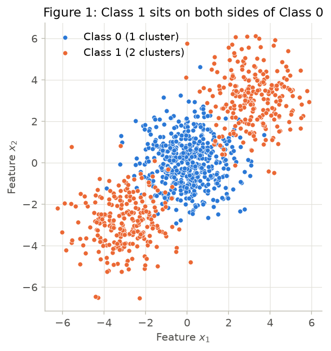
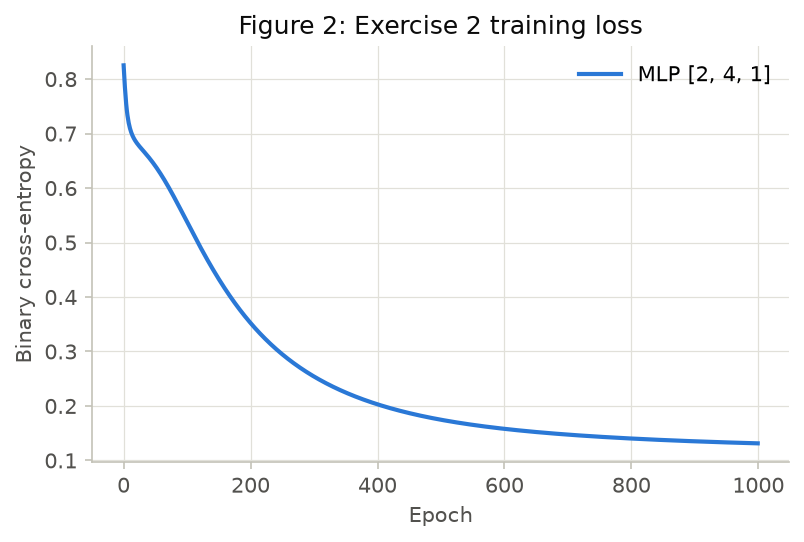
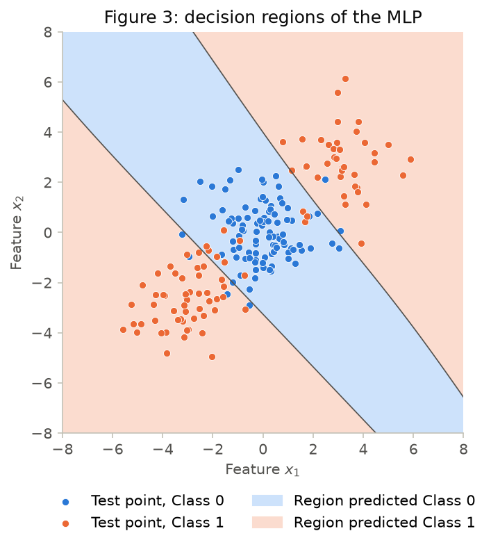
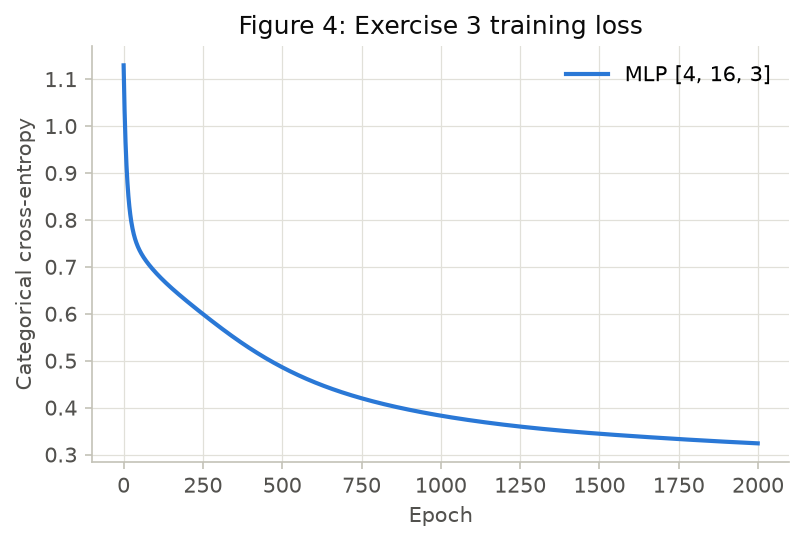
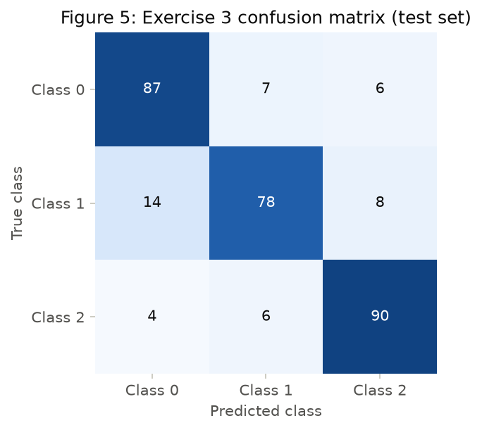
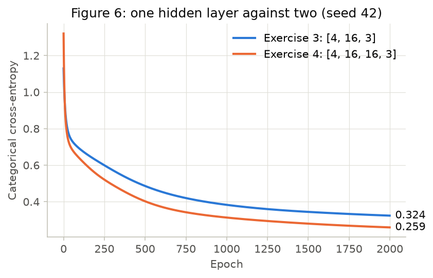

# 3. MLP

Every number and figure in this report comes from two scripts, run from the repository root:

```bash
pip install -r requirements.txt
python docs/exercises/mlp/code/check_gradients.py
python docs/exercises/mlp/code/exercises.py
```

Exercises 2, 3 and 4A all draw from one `rng = np.random.default_rng(42)`. Item 4B requires several seeds, so seed 42 is those same runs and seeds 43 to 46 use their own generators. The reported numbers came out identical on numpy 2.5.3 with scikit-learn 1.9.1 and on numpy 1.26.4 with scikit-learn 1.8.0.

## Exercise 1

Values are carried at full precision and shown rounded to six decimals, so a product of rounded values can differ in the last digit. `code/check_gradients.py` confirms every result below against `code/mlp.py`.

### A — Forward pass

Hidden pre-activations, $z^{(1)} = W^{(1)}x + b^{(1)}$:

$$z^{(1)}_1 = 0.3(0.5) + (-0.1)(-0.2) + 0.1 = 0.15 + 0.02 + 0.1 = 0.270000$$

$$z^{(1)}_2 = 0.2(0.5) + 0.4(-0.2) - 0.2 = 0.10 - 0.08 - 0.20 = -0.180000$$

Hidden activations:

$$h^{(1)} = [\tanh(0.27),\ \tanh(-0.18)] = [0.263625,\ -0.178081]$$

Output pre-activation:

$$u^{(2)} = 0.5(0.263625) + (-0.3)(-0.178081) + 0.2 = 0.131812 + 0.053424 + 0.2 = 0.385237$$

Output and loss:

$$\hat{y} = \tanh(0.385237) = 0.367247$$

$$L = (1 - 0.367247)^2 = (0.632753)^2 = 0.400377$$

### B — Backward pass

Start from the loss and apply $\frac{d}{du}\tanh(u) = 1 - \tanh^2(u)$:

$$\frac{\partial L}{\partial \hat{y}} = -2(y - \hat{y}) = -2(0.632753) = -1.265507$$

$$\frac{\partial L}{\partial u^{(2)}} = \frac{\partial L}{\partial \hat{y}}(1 - \hat{y}^2) = -1.265507 \times (1 - 0.134870) = -1.265507 \times 0.865130 = -1.094828$$

Output layer. Since $u^{(2)} = W^{(2)}h^{(1)} + b^{(2)}$:

$$\frac{\partial L}{\partial W^{(2)}} = \frac{\partial L}{\partial u^{(2)}}\,h^{(1)} = -1.094828 \times [0.263625,\ -0.178081] = [-0.288624,\ 0.194968]$$

$$\frac{\partial L}{\partial b^{(2)}} = \frac{\partial L}{\partial u^{(2)}} = -1.094828$$

Propagate back through $W^{(2)}$, then through $\tanh$, where $1 - (h^{(1)})^2 = [1 - 0.069498,\ 1 - 0.031713] = [0.930502,\ 0.968287]$:

$$\frac{\partial L}{\partial h^{(1)}} = \frac{\partial L}{\partial u^{(2)}}\,W^{(2)} = -1.094828 \times [0.5,\ -0.3] = [-0.547414,\ 0.328448]$$

$$\frac{\partial L}{\partial z^{(1)}} = [-0.547414 \times 0.930502,\ 0.328448 \times 0.968287] = [-0.509370,\ 0.318032]$$

Hidden layer. Since $z^{(1)} = W^{(1)}x + b^{(1)}$:

$$\frac{\partial L}{\partial W^{(1)}} = \frac{\partial L}{\partial z^{(1)}}\,x^\top = \begin{bmatrix} -0.509370(0.5) & -0.509370(-0.2) \\ 0.318032(0.5) & 0.318032(-0.2) \end{bmatrix} = \begin{bmatrix} -0.254685 & 0.101874 \\ 0.159016 & -0.063606 \end{bmatrix}$$

$$\frac{\partial L}{\partial b^{(1)}} = \frac{\partial L}{\partial z^{(1)}} = [-0.509370,\ 0.318032]$$

### C — Parameter update

The statement says eight parameters, but the network has nine scalars: 4 in $W^{(1)}$, 2 in $b^{(1)}$, 2 in $W^{(2)}$ and 1 in $b^{(2)}$. All nine are updated with $\eta = 0.3$:

| Parameter | Old value | $\eta \times$ gradient | New value |
|---|---|---|---|
| $W^{(2)}_1$ | 0.5 | -0.086587 | **0.586587** |
| $W^{(2)}_2$ | -0.3 | 0.058490 | **-0.358490** |
| $b^{(2)}$ | 0.2 | -0.328448 | **0.528448** |
| $W^{(1)}_{11}$ | 0.3 | -0.076405 | **0.376405** |
| $W^{(1)}_{12}$ | -0.1 | 0.030562 | **-0.130562** |
| $W^{(1)}_{21}$ | 0.2 | 0.047705 | **0.152295** |
| $W^{(1)}_{22}$ | 0.4 | -0.019082 | **0.419082** |
| $b^{(1)}_1$ | 0.1 | -0.152811 | **0.252811** |
| $b^{(1)}_2$ | -0.2 | 0.095410 | **-0.295410** |

The loss goes **down** on a second forward pass, from 0.400377 to **0.083417**:

$$z^{(1)} = [0.467126,\ -0.303079],\quad h^{(1)} = [0.435874,\ -0.294127],\quad u^{(2)} = 0.889568,\quad \hat{y} = 0.711181$$

The reason is that every parameter moved against its own gradient. To first order the change is $\Delta L \approx -\eta\lVert\nabla L\rVert^2 = -0.3 \times 1.785141 = -0.535542$, which is always negative. The actual change is -0.316960: $\eta = 0.3$ is a large step, so the first-order estimate overshoots, but the direction holds. The output moved from 0.367247 toward the target of 1.

## Exercise 2

### A — Generate the data

```python
centers = np.array([[0., 0.], [3., 3.], [-3., -3.]])
X, c = make_blobs(n_samples=[500, 250, 250], centers=centers,
                  cluster_std=1.2, random_state=42)
y = (c > 0).astype(int)
X_train, X_test, y_train, y_test = train_test_split(
    X, y, test_size=0.2, random_state=42, stratify=y)
```



### B — Establish the baseline

`LogisticRegression` reaches a test accuracy of **47.50%** (95 of 200 points).

### C — Implement the MLP

The network lives in `code/mlp.py`. `MLP` takes the layer sizes and the loss as arguments, so Exercises 3 and 4 use the same class. Data, training and figures live in `code/exercises.py`.

??? example "The network — `code/mlp.py`"

    ``` python
    --8<-- "docs/exercises/mlp/code/mlp.py"
    ```

??? example "Data, training and figures — `code/exercises.py`"

    ``` python
    --8<-- "docs/exercises/mlp/code/exercises.py"
    ```

`code/check_gradients.py` compares the backward pass with central finite differences on every loss. The worst gap is below $3 \times 10^{-10}$.

??? example "Gradient checks — `code/check_gradients.py`"

    ``` python
    --8<-- "docs/exercises/mlp/code/check_gradients.py"
    ```

| | |
|---|---|
| Architecture | `[2, 4, 1]`: tanh hidden layer, sigmoid output, 17 parameters |
| Loss | Binary cross-entropy |
| Training | Full-batch gradient descent, Xavier initialization |
| Learning rate | 0.1 |
| Epochs | 1000 |
| Final train loss | 0.1314 |
| Train accuracy | 96.25% |
| Test accuracy | **92.00%** |





### D — Analysis

The baseline scores below 50% because a straight line has nothing to work with here. The two class means almost coincide: (0.02, 0.05) for Class 0 and (0.21, 0.20) for Class 1. With the means nearly equal, no direction favors either class, so the logistic regression weights collapse to almost nothing: [0.0296, 0.0015] with intercept -0.0031. Its boundary lands near the vertical line $x_1 \approx 0.10$. That line puts one Class 1 cluster on each side and cuts Class 0 in half, so about half of each class is wrong by construction. The expected result is a coin flip, and 47.50% is that coin flip landing slightly low on a 200-point test set. The model is not learning the wrong rule; it has no rule to learn.

Figure 3 shows what the MLP does instead. The region assigned to Class 1 is **two separate pieces**, one to the northeast and one to the southwest, with a diagonal Class 0 band between them. Along the line $x_1 = x_2$, which runs through all three cluster centers, the boundary is crossed twice, at -1.59 and at 1.69.

No single line can produce that shape, because the positive side of a line is convex: if two points are on it, so is their midpoint. Here (3, 3) and (-3, -3) both belong to Class 1, and their midpoint (0, 0) belongs to Class 0. Each hidden tanh neuron gives a soft step across one line, and the output layer combines those steps into "outside the band". That is what the hidden layer buys, and it moves the accuracy from 47.50% to 92.00%. The remaining 8% is overlap between the clusters, visible in Figure 3 as points on the wrong side of the band.

## Exercise 3

### A — Generate the data

```python
X, y = make_classification(n_samples=1500, n_features=4, n_informative=4,
                           n_redundant=0, n_repeated=0, n_classes=3,
                           n_clusters_per_class=2, class_sep=1.0,
                           random_state=42)
data = train_test_split(X, y, test_size=0.2, random_state=42, stratify=y)
```

### B — Adapt the network

Forward, backward and update are the same `MLP` code as Exercise 2, untouched (extra point). Only the arguments change: `MLP([4, 16, 3], SoftmaxCCE(), rng)` instead of `MLP([2, 4, 1], SigmoidBCE(), rng)`.

**Derivation of $\partial L / \partial u$.** For one sample with one-hot target $y$:

$$p_k = \frac{e^{u_k}}{\sum_j e^{u_j}}, \qquad L = -\sum_k y_k \log p_k$$

Taking the log cancels the exponential:

$$\log p_k = u_k - \log \sum_j e^{u_j}$$

Differentiating with respect to $u_i$, the normalizer term produces $p_i$ itself:

$$\frac{\partial \log p_k}{\partial u_i} = \delta_{ki} - \frac{e^{u_i}}{\sum_j e^{u_j}} = \delta_{ki} - p_i$$

Substituting into the loss, and using $\sum_k y_k = 1$:

$$\frac{\partial L}{\partial u_i} = -\sum_k y_k(\delta_{ki} - p_i) = -y_i + p_i \sum_k y_k = p_i - y_i$$

So $\partial L / \partial u = p - y$: prediction minus target. It is simple because the log in the cross-entropy undoes the exponential in the softmax. Sigmoid with binary cross-entropy has the same form, which is why the backward pass needs no change between Exercises 2 and 3. Averaged over a batch, each sample contributes $(p - y)/N$.

### C — Train and evaluate

| | |
|---|---|
| Architecture | `[4, 16, 3]`: tanh hidden layer, softmax output, 131 parameters |
| Loss | Categorical cross-entropy |
| Training | Full-batch gradient descent, Xavier initialization |
| Learning rate | 0.1 |
| Epochs | 2000 |
| Final train loss | 0.3239 |
| Train accuracy | 88.08% |
| Test accuracy | **85.00%** |





### D — Analysis

**The most-confused pair is classes 0 and 1**, with 21 errors: 14 true Class 1 predicted as Class 0, and 7 the other way. Classes 1 and 2 have 14 errors and classes 0 and 2 have 10. The same pair comes out on top in all five seeds of Exercise 4.

The cluster structure explains it. Each class is two clusters, six in total. Regenerating the data with `shuffle=False` returns the same points in generation order (the script checks this), which reveals the true cluster of each point. Tracing the errors back shows that **16 of the 21 errors come from a single pair of clusters**:

- Cluster 1 (Class 1) is the worst of the six: 16 of its 49 test points are wrong, 11 of them predicted as Class 0.
- Cluster 0 (Class 0) contributes the other 5, predicted as Class 1.
- Their centers are only 2.03 apart, while their spreads are 2.54 and 2.71 (rms distance of a cluster's points to its center), the two largest of the six. They overlap in the 4D space.
- Counting each point's nearest neighbour, 68 of the 1500 links join these two clusters, the most of any cross-class pair. The next pair, clusters 1 and 2, has 44.

Center distance alone does not decide it. The closest cross-class centers are clusters 2 and 4 (Classes 2 and 1), at 1.92. But cluster 4 is the tightest of the six, with a spread of 1.81, and only 4 of its 49 test points are wrong. What matters is overlap, which is distance relative to spread.

**Baseline.** Logistic regression reaches 66.33%, against 85.00% for the MLP, a gain of 18.67 points. The linear softmax gives each class one convex region, which cannot hold two separate clusters without also taking what lies between them. The hidden layer lets one class own two disjoint regions, the same mechanism as Exercise 2.

## Exercise 4

### A — Train the deeper network

Same data, split, learning rate (0.1) and epochs (2000) as Exercise 3.

| | |
|---|---|
| Architecture | `[4, 16, 16, 3]`: two tanh hidden layers, softmax output, 403 parameters |
| Final train loss | 0.2595 |
| Train accuracy | 90.83% |
| Test accuracy | **86.00%** |

### B — Compare



Mean and standard deviation over five seeds (42 to 46):

| | hidden layers | parameters | final train loss | test accuracy |
|---|---|---|---|---|
| Exercise 3 | 1 | 131 | 0.3222 ± 0.0029 | 84.27% ± 0.44 |
| Exercise 4 | 2 | 403 | 0.2675 ± 0.0095 | 85.67% ± 0.37 |

Test accuracy per seed:

| Seed | Exercise 3 | Exercise 4 | Difference |
|---|---|---|---|
| 42 | 85.00% | 86.00% | +1.00 |
| 43 | 84.33% | 85.67% | +1.33 |
| 44 | 84.00% | 85.67% | +1.67 |
| 45 | 84.33% | 86.00% | +1.67 |
| 46 | 83.67% | 85.00% | +1.33 |
| **Mean** | **84.27%** | **85.67%** | **+1.40** |

### C — Analysis

**The deeper network won here, by 1.40 points on average and in all five seeds.** The statement expected the opposite. This is what was measured, with no tuning toward either result. The size matters: 1.40 points is about 4 of the 300 test points, and all seeds share one test split, so the seeds measure initialization noise, not how much the result would move on other data.

**The gain comes from capacity, not depth.** Adding the second layer also tripled the parameter count, so depth was not really the only change. Two extra runs outside the required comparison match the parameter counts to isolate depth. They use the same seeds, learning rate and data, with a fresh generator for every seed, which is why `[4, 16, 3]` differs slightly from the table above:

| Network | Epochs | Parameters | Train loss | Train accuracy | Test accuracy |
|---|---|---|---|---|---|
| `[4, 16, 3]` | 2000 | 131 | 0.3235 | 88.02% | 84.33% |
| `[4, 8, 8, 3]` | 2000 | 139 | 0.3201 | 87.98% | 84.33% |
| `[4, 50, 3]` | 2000 | 403 | 0.2988 | 89.07% | 85.60% |
| `[4, 16, 16, 3]` | 2000 | 403 | 0.2715 | 90.13% | 85.47% |
| `[4, 16, 3]` | 6000 | 131 | 0.2759 | 90.02% | 84.33% |
| `[4, 16, 16, 3]` | 6000 | 403 | 0.2036 | 92.67% | 85.13% |

At about 135 parameters, one and two hidden layers tie at 84.33%. At 403 parameters, the wide single layer scores 85.60% against 85.47% for two layers. The accuracy follows the parameter count, and the extra layer alone adds nothing measurable.

**That fits the data.** There are six clusters in four dimensions, and they have no compositional structure. A single hidden layer with enough units can already carve a region around each cluster, so a second layer has no features of features to build. In representational terms it could compose boundaries, but this problem does not need that. Its cost shows in optimization: the final train loss varies about three times more across seeds (std 0.0095 against 0.0029), which is consistent with a harder path for the gradient, now passing through one more layer of tanh and weights.

**The training loss does not tell the same story as the test accuracy.** At equal parameter counts, two layers reach a lower train loss (0.2715 against 0.2988), yet the test accuracy does not improve (85.47% against 85.60%). Tripling the budget makes the gap clearer. The train loss of `[4, 16, 16, 3]` falls from 0.2715 to 0.2036 and its train accuracy rises to 92.67%, while its test accuracy drops from 85.47% to 85.13%. The train loss of `[4, 16, 3]` falls from 0.3235 to 0.2759 while its test accuracy stays at 84.33%. Past this point the networks are most likely fitting the overlap between clusters, which does not generalize.

**Extra depth would pay off on data that is compositional**, where useful features are built from simpler ones: images (edges, then parts, then objects), or parity-like and deeply nested patterns, where a shallow network needs far more units than a deep one for the same function.

## Results summary

| # | Quantity | Value |
|---|---|---|
| 1 | Ex. 1 — $z^{(1)}$ and $h^{(1)}$ | $z^{(1)} = [0.2700,\ -0.1800]$; $h^{(1)} = [0.263625,\ -0.178081]$ |
| 2 | Ex. 1 — $u^{(2)}$, $\hat{y}$ and $L$ | $u^{(2)} = 0.385237$; $\hat{y} = 0.367247$; $L = 0.400377$ |
| 3 | Ex. 1 — the eight updated parameters | $W^{(2)} = [0.586587,\ -0.358490]$; $b^{(2)} = 0.528448$; $W^{(1)} = [[0.376405,\ -0.130562],\ [0.152295,\ 0.419082]]$; $b^{(1)} = [0.252811,\ -0.295410]$ (nine scalars, see 1C) |
| 4 | Ex. 2 — linear baseline test accuracy | 47.50% |
| 5 | Ex. 2 — architecture and test accuracy | `[2, 4, 1]`; 92.00% |
| 6 | Ex. 3 — architecture and test accuracy | `[4, 16, 3]`; 85.00% |
| 7 | Ex. 3 — most-confused class pair | Classes 0 and 1 (21 errors) |
| 8 | Ex. 4 — architecture and test accuracy | `[4, 16, 16, 3]`; 86.00% |
| 9 | Ex. 4 — accuracy difference against Ex. 3 (mean over ≥ 3 seeds) | +1.40 points (Ex. 4 minus Ex. 3, mean over 5 seeds, std 0.25) |
