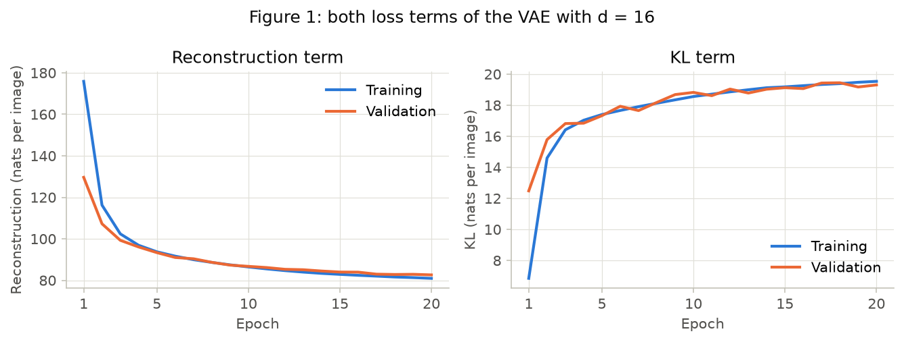
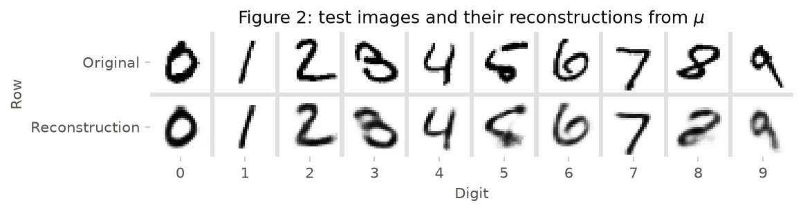
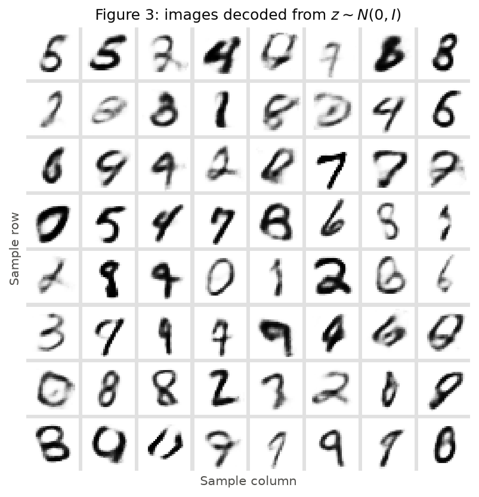
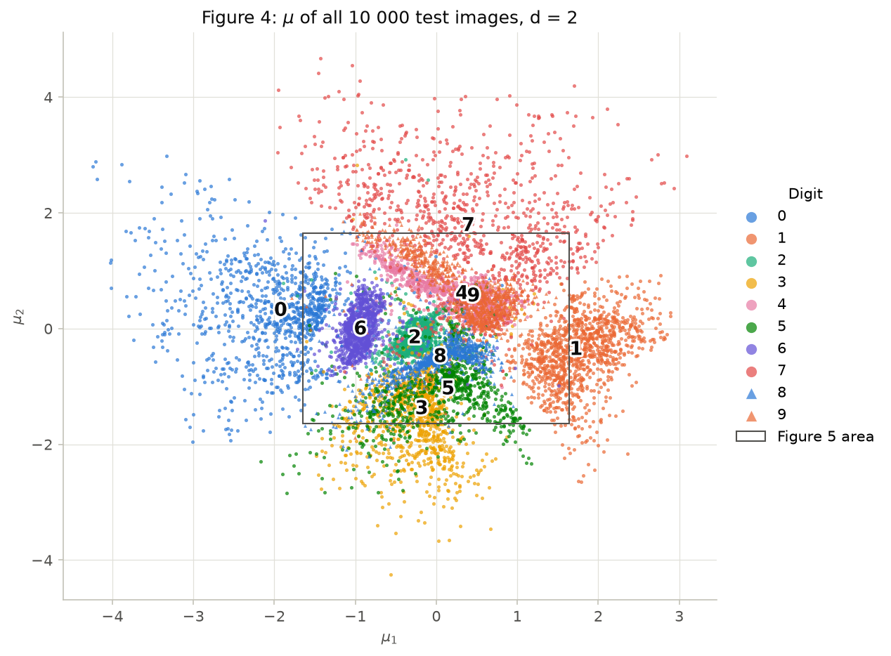
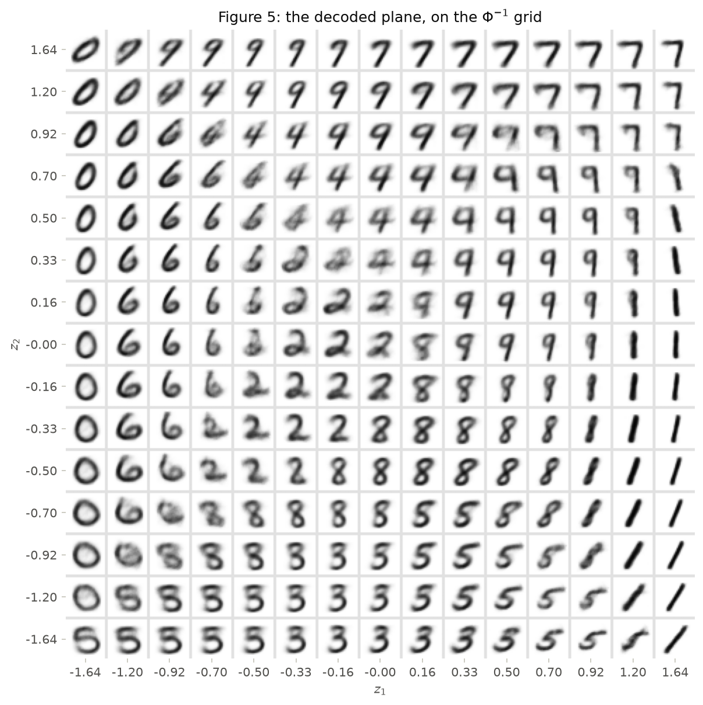
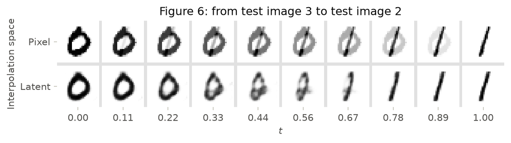

# 4. VAE

Every number and figure in this report comes from one script, run from the repository root. It downloads MNIST into `./data` on the first run, then takes about a minute on one CPU thread:

```bash
pip install -r requirements.txt
python docs/exercises/vae/code/exercises.py
```

`torch.manual_seed(42)` runs before each model is built, and Figure 3 uses `torch.manual_seed(0)`. Two runs in a row gave identical numbers and figures. All loss values are in nats per image.

## Exercise 1

### A — Load and split the data

```python
train_full = datasets.MNIST("data", train=True, download=True, transform=transforms.ToTensor())
test = datasets.MNIST("data", train=False, download=True, transform=transforms.ToTensor())
train, val = random_split(train_full, [50_000, 10_000],
                          generator=torch.Generator().manual_seed(42))
```

This gives 50 000 training, 10 000 validation and 10 000 test images. For speed, the script then indexes the pixels directly using the split's indices. An assertion checks that the values match `ToTensor`. The test set is only touched after each model finishes training.

### B — Build the model

The architecture is the one specified: encoder $784 \to 512 \to 256$, two heads $256 \to d$ for $\mu$ and $\log\sigma^2$, and decoder $d \to 256 \to 512 \to 784$ with a sigmoid output, using $d = 16$. Three parts are hand-written in `code/vae.py`:

- **Reparameterization:** $z = \mu + \sigma \odot \epsilon$, with $\epsilon \sim N(0, I)$ and $\sigma = e^{\frac{1}{2}\log\sigma^2}$.
- **Reconstruction:** `F.binary_cross_entropy(x_hat, x, reduction="sum")` divided by the batch size.
- **KL:** the closed form $\frac{1}{2}\sum_i(\mu_i^2 + \sigma_i^2 - 1 - \log\sigma_i^2)$, written out and divided by the batch size.

??? example "The VAE, its loss and its training loop — `code/vae.py`"

    ``` python
    --8<-- "docs/exercises/vae/code/vae.py"
    ```

### C — Train

Adam with learning rate $10^{-3}$, batch size 128, 20 epochs and $\beta = 1$.

| Test set, $d = 16$ | Nats per image |
|---|---|
| Reconstruction | **81.96** |
| KL | **19.36** |
| Negative ELBO | **101.31** |

The negative ELBO is summed before rounding, so it differs by 0.01 from adding the two rounded values.

| Epoch | Train reconstruction | Train KL | Validation reconstruction | Validation KL |
|---|---|---|---|---|
| 1 | 175.88 | 6.85 | 129.63 | 12.48 |
| 2 | 116.25 | 14.60 | 107.25 | 15.78 |
| 3 | 102.40 | 16.41 | 99.28 | 16.81 |
| 5 | 93.75 | 17.40 | 93.35 | 17.32 |
| 10 | 86.44 | 18.56 | 86.74 | 18.82 |
| 20 | 80.96 | 19.53 | 82.62 | 19.30 |

Training numbers are the running average over each epoch, while validation is measured at its end. That is why validation looks better in epoch 1.



??? example "Data, figures and reported numbers — `code/exercises.py`"

    ``` python
    --8<-- "docs/exercises/vae/code/exercises.py"
    ```

### D — Reconstructions and samples

Figure 2 uses the first test image of each digit, at test indices 3, 2, 1, 18, 4, 8, 11, 0, 61 and 7.





### E — Analysis

**Why would the optimizer pay more KL?** Because the total is what it minimizes, and the trade is very favorable early on. A code that matches the prior says nothing about the image, so the decoder can only output something like an average digit. Moving each $q(z \mid x)$ away from the prior costs KL but tells the decoder which image it is looking at. From epoch 1 to epoch 2 the training KL rose by 7.75 nats (6.85 to 14.60), while the reconstruction fell by 59.63 (175.88 to 116.25). The total still fell by 51.88. Part of that drop comes from the decoder simply getting better, but the direction of the trade is clear.

**Why does Figure 3 look worse than Figure 2?**

1. *Where the samples land.* Figure 2 decodes $\mu$ from real images, a region the decoder was trained on. Prior samples can fall between the encoded clouds, where no training image lives. Eleven of the 16 dimensions are active (KL above 0.1), so distances are measured only in those. The median distance to the nearest encoded training image is 1.49 for prior samples, against 1.19 for $z$ sampled from test posteriors, about 25% farther. At the 90th percentile it is 1.99 against 1.57. A code between clouds of different digits decodes to a hybrid, which is what the non-digits in Figure 3 look like.
2. *What the decoder outputs.* For a given $z$, the decoder returns one probability per pixel, and the loss-optimal value is the average of all images consistent with that code. Several sharp images average into a blurry one. The objective asks for this, so it is not a bug, and it happens even when $z$ lands in a well-trained region.

**Why decode $\mu$ in Figure 2?** $\mu$ is the center of $q(z \mid x)$, the encoder's best single answer for that image. A sampled $z$ adds noise $\sigma\epsilon$, so the picture would change on every draw and would mix what the model retained with sampling noise. On the test set, decoding $\mu$ costs 76.53 nats of reconstruction against 81.96 for a sampled $z$. The reported 81.96 keeps the sample because that is the ELBO's term.

## Exercise 2

### A — Train a 2-D VAE

Same model, data, seed, $\beta$ and budget, changing only $d$:

| Test set | Reconstruction | KL | Negative ELBO |
|---|---|---|---|
| $d = 16$ | 81.96 | 19.36 | 101.31 |
| $d = 2$ | **135.26** | **6.69** | 141.95 |

Going down to two dimensions costs 53.30 nats of reconstruction and saves only 12.67 of KL, so the negative ELBO is 40.64 nats worse.

### B — The encoded test set

The black rectangle marks the area decoded in Figure 5, which holds 75.0% of the test points.



### C — The decoded plane

Evenly spaced quantiles put the same probability between neighboring grid values under $N(0, 1)$, and the two dimensions of the prior are independent, so every cell holds the same prior mass.



### D — Interpolation

The interpolated test images are **index 3 (digit 0)** and **index 2 (digit 1)**. The latent row uses the $d = 16$ model from Exercise 1.



### E — Analysis

**Which digits overlap?** Mainly 4 and 9, then 3 and 5. For 25.5% of the test points, the nearest neighbor in Figure 4 is a different digit. Counting those links per pair gives 574 for 4 and 9, and 423 for 3 and 5. The next pairs are 5 and 8 (229), 3 and 8 (194), and 7 and 9 (190). The medians of 4 and 9 are only 0.15 apart, at (0.32, 0.60) and (0.46, 0.55).

Figure 5 shows the same transition. In the row $z_2 = 0.70$, the images read as 4 up to $z_1 = 0.16$ and as 9 from $z_1 = 0.50$. Between them, at $z_1 = 0.33$, the open top of the 4 is partly closed and smudged, an image that could be read as either digit. The bottom row shows the same for 3 and 5 around $z_1 = 0.33$ to $0.50$, where the top stroke changes shape. The in-between images are blurrier than those at the center of each digit's region.

**What do two numbers force the model to throw away?** Style. The KL gives an upper bound on what the code carries per image: 6.69 nats at $d = 2$. Naming a digit alone takes $\ln 10 = 2.30$ nats, which leaves at most 4.39 nats for everything else, against 17.06 at $d = 16$. Figure 5 is the evidence. A position in the plane decodes to exactly one image, and most of the plane goes to digit identity. What remains is mostly slant: the 1s in the right column lean more toward the bottom, and the 0s in the left column stand up. Stroke thickness, loop size and each writer's quirks have no axis of their own, so they get averaged away. That is where the extra 53.30 nats of reconstruction go.

**Which interpolation looks like digits?** The latent row. The pixel row is a weighted overlay: at $t = 0.44$ and $0.56$ the ring of the 0 and the bar of the 1 appear together at partial intensity, which no digit looks like. A straight line between two images in pixel space leaves the set of digit images.

The latent row always decodes a single shape: the ring narrows and collapses into the bar, reaching a clean 1 by $t = 0.78$. The line between $\mu_a$ and $\mu_b$ stays in a space where the KL made the encoded clouds overlap, and the decoder learned to output digit-like images there. It is not perfect: at $t = 0.44$ and $0.56$ the images are blurry and look like a rough 8, because the path crosses the area between the two digits' regions.

## Results summary

| # | Quantity | Value |
|---|---|---|
| 1 | Ex. 1 — test reconstruction, KL and negative ELBO ($d = 16$) | 81.96; 19.36; 101.31 nats per image |
| 2 | Ex. 1 — validation KL at the first and at the last epoch | 12.48 (epoch 1); 19.30 (epoch 20) |
| 3 | Ex. 2 — test reconstruction and KL ($d = 2$) | 135.26; 6.69 nats per image |
| 4 | Ex. 2 — the two test indices interpolated | 3 (digit 0) and 2 (digit 1) |
